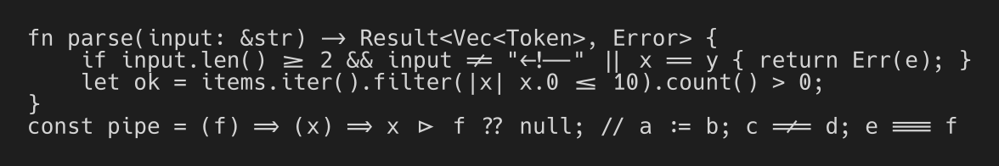
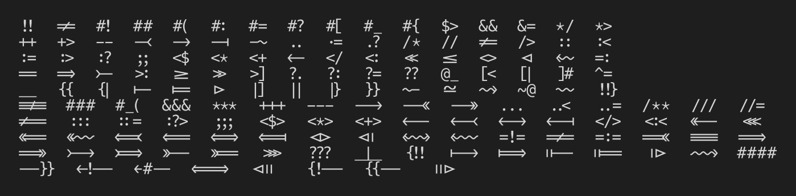
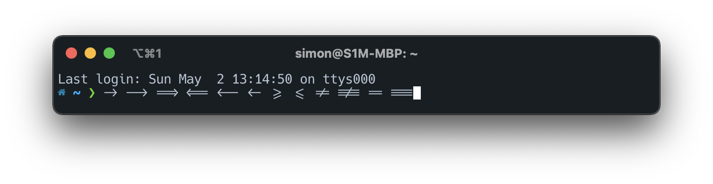

# Hack 1337

My personal edit of the legendary [Hack](https://github.com/source-foundry/Hack) font: a monospaced
[Nerd Font](https://www.nerdfonts.com/) with programming ligatures and a tighter line height.

| | |
| --- | --- |
| Base font | Hack 3.003 |
| Ligatures | 150, from [JetBrains Mono](https://github.com/JetBrains/JetBrainsMono) 2.304 ([full list](docs/ligatures.md)) |
| Icons | [Nerd Fonts](https://github.com/ryanoasis/nerd-fonts) 3.5.1, complete set, single-width ("Mono") |
| Styles | Regular, Italic, Bold, Bold Italic |
| Formats | `ttf/`, `otf/`, `woff/`, `woff2/` |

## Ligatures

Ligatures are in the `calt` feature, so most editors only need ligatures switched on:

- **VS Code**: `"editor.fontFamily": "'Hack 1337'", "editor.fontLigatures": true`
- **iTerm2**: Settings → Profiles → Text → *Use ligatures*
- **Ghostty**: `font-family = "Hack 1337"` (ligatures are on by default)
- **kitty**: `font_family Hack 1337` (ligatures are on by default)

Don't like `<=` turning into `≤`? Enable the `ss01` stylistic set to keep comparison operators
plain, e.g. in VS Code: `"editor.fontLigatures": "'calt', 'ss01'"`.

## Nerd Font icons

Every Nerd Fonts 3.5.1 icon set is included (Powerline, Powerline Extra, Font Awesome, Material
Design, Codicons, Devicons, Octicons, Seti, Font Logos, Weather, Pomicons, IEC Power Symbols). All
icons are single-width, so terminals keep a strict grid.

> **Upgrading from 1.x:** Nerd Fonts 3 removed the old Material Design Icons range
> `U+F500–U+FD46` (`nf-mdi-*`). They now live at `U+F0001+` (`nf-md-*`). If your prompt shows
> empty boxes, update its icon names. powerlevel10k does this when you rerun `p10k configure`.

## Building

The fonts are built from the upstream releases with one command (`make fonts`). See
[docs/BUILDING.md](docs/BUILDING.md) for how it works and how to change it.

## License

- **Build scripts** (`scripts/`, `src/`, `Makefile`): [MIT](LICENSE).
- **Fonts**: Hack is MIT (with the Bitstream Vera and DejaVu notices from
  [Hack's license](https://github.com/source-foundry/Hack/blob/master/LICENSE.md)). The ligature
  glyphs come from JetBrains Mono, so the font files are also covered by the
  [SIL Open Font License 1.1](OFL.txt). Nerd Fonts icons keep their
  [respective licenses](https://github.com/ryanoasis/nerd-fonts/blob/master/LICENSE).
