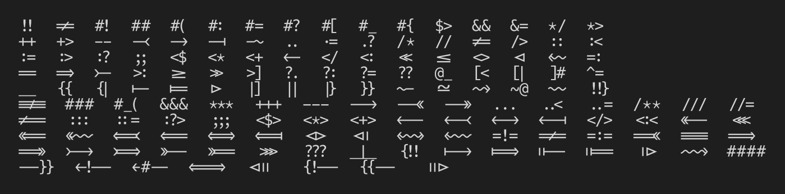

# Ligatures

Hack 1337 ships the 152 programming ligatures of JetBrains Mono, copied into Hack by `scripts/ligaturize.py`. They live in the `calt` (contextual alternates) feature.

This file is generated by `make previews`.

## Stylistic sets

| Feature | Effect |
| --- | --- |
| `ss01` | Plain comparison operators: no ligatures for `<=` `>=` `==` `!=` (and sequences built on them, such as `===` `!==` `<=>` `==>`). |

## All ligatures

| Ligature | Characters |
| --- | --- |
| <code>!!</code> | `U+0021` `U+0021` |
| <code>!=</code> | `U+0021` `U+003D` |
| <code>#!</code> | `U+0023` `U+0021` |
| <code>##</code> | `U+0023` `U+0023` |
| <code>#(</code> | `U+0023` `U+0028` |
| <code>#:</code> | `U+0023` `U+003A` |
| <code>#=</code> | `U+0023` `U+003D` |
| <code>#?</code> | `U+0023` `U+003F` |
| <code>#[</code> | `U+0023` `U+005B` |
| <code>#_</code> | `U+0023` `U+005F` |
| <code>#{</code> | `U+0023` `U+007B` |
| <code>$></code> | `U+0024` `U+003E` |
| <code>&&</code> | `U+0026` `U+0026` |
| <code>&=</code> | `U+0026` `U+003D` |
| <code>*/</code> | `U+002A` `U+002F` |
| <code>*></code> | `U+002A` `U+003E` |
| <code>++</code> | `U+002B` `U+002B` |
| <code>+></code> | `U+002B` `U+003E` |
| <code>--</code> | `U+002D` `U+002D` |
| <code>-<</code> | `U+002D` `U+003C` |
| <code>-></code> | `U+002D` `U+003E` |
| <code>-&#124;</code> | `U+002D` `U+007C` |
| <code>-~</code> | `U+002D` `U+007E` |
| <code>..</code> | `U+002E` `U+002E` |
| <code>.=</code> | `U+002E` `U+003D` |
| <code>.?</code> | `U+002E` `U+003F` |
| <code>/*</code> | `U+002F` `U+002A` |
| <code>//</code> | `U+002F` `U+002F` |
| <code>/=</code> | `U+002F` `U+003D` |
| <code>/></code> | `U+002F` `U+003E` |
| <code>::</code> | `U+003A` `U+003A` |
| <code>:<</code> | `U+003A` `U+003C` |
| <code>:=</code> | `U+003A` `U+003D` |
| <code>:></code> | `U+003A` `U+003E` |
| <code>:?</code> | `U+003A` `U+003F` |
| <code>;;</code> | `U+003B` `U+003B` |
| <code><$</code> | `U+003C` `U+0024` |
| <code><*</code> | `U+003C` `U+002A` |
| <code><+</code> | `U+003C` `U+002B` |
| <code><-</code> | `U+003C` `U+002D` |
| <code></</code> | `U+003C` `U+002F` |
| <code><:</code> | `U+003C` `U+003A` |
| <code><<</code> | `U+003C` `U+003C` |
| <code><=</code> | `U+003C` `U+003D` |
| <code><></code> | `U+003C` `U+003E` |
| <code><&#124;</code> | `U+003C` `U+007C` |
| <code><~</code> | `U+003C` `U+007E` |
| <code>=:</code> | `U+003D` `U+003A` |
| <code>==</code> | `U+003D` `U+003D` |
| <code>=></code> | `U+003D` `U+003E` |
| <code>>-</code> | `U+003E` `U+002D` |
| <code>>:</code> | `U+003E` `U+003A` |
| <code>>=</code> | `U+003E` `U+003D` |
| <code>>></code> | `U+003E` `U+003E` |
| <code>>]</code> | `U+003E` `U+005D` |
| <code>?.</code> | `U+003F` `U+002E` |
| <code>?:</code> | `U+003F` `U+003A` |
| <code>?=</code> | `U+003F` `U+003D` |
| <code>??</code> | `U+003F` `U+003F` |
| <code>@_</code> | `U+0040` `U+005F` |
| <code>[<</code> | `U+005B` `U+003C` |
| <code>[&#124;</code> | `U+005B` `U+007C` |
| <code>]#</code> | `U+005D` `U+0023` |
| <code>^=</code> | `U+005E` `U+003D` |
| <code>__</code> | `U+005F` `U+005F` |
| <code>{{</code> | `U+007B` `U+007B` |
| <code>{&#124;</code> | `U+007B` `U+007C` |
| <code>&#124;-</code> | `U+007C` `U+002D` |
| <code>&#124;=</code> | `U+007C` `U+003D` |
| <code>&#124;></code> | `U+007C` `U+003E` |
| <code>&#124;]</code> | `U+007C` `U+005D` |
| <code>&#124;&#124;</code> | `U+007C` `U+007C` |
| <code>&#124;}</code> | `U+007C` `U+007D` |
| <code>}}</code> | `U+007D` `U+007D` |
| <code>~-</code> | `U+007E` `U+002D` |
| <code>~=</code> | `U+007E` `U+003D` |
| <code>~></code> | `U+007E` `U+003E` |
| <code>~@</code> | `U+007E` `U+0040` |
| <code>~~</code> | `U+007E` `U+007E` |
| <code>!!}</code> | `U+0021` `U+0021` `U+007D` |
| <code>!==</code> | `U+0021` `U+003D` `U+003D` |
| <code>###</code> | `U+0023` `U+0023` `U+0023` |
| <code>#_(</code> | `U+0023` `U+005F` `U+0028` |
| <code>&&&</code> | `U+0026` `U+0026` `U+0026` |
| <code>***</code> | `U+002A` `U+002A` `U+002A` |
| <code>+++</code> | `U+002B` `U+002B` `U+002B` |
| <code>---</code> | `U+002D` `U+002D` `U+002D` |
| <code>--></code> | `U+002D` `U+002D` `U+003E` |
| <code>-<<</code> | `U+002D` `U+003C` `U+003C` |
| <code>->></code> | `U+002D` `U+003E` `U+003E` |
| <code>...</code> | `U+002E` `U+002E` `U+002E` |
| <code>..<</code> | `U+002E` `U+002E` `U+003C` |
| <code>..=</code> | `U+002E` `U+002E` `U+003D` |
| <code>/**</code> | `U+002F` `U+002A` `U+002A` |
| <code>///</code> | `U+002F` `U+002F` `U+002F` |
| <code>//=</code> | `U+002F` `U+002F` `U+003D` |
| <code>/==</code> | `U+002F` `U+003D` `U+003D` |
| <code>:::</code> | `U+003A` `U+003A` `U+003A` |
| <code>::=</code> | `U+003A` `U+003A` `U+003D` |
| <code>:?></code> | `U+003A` `U+003F` `U+003E` |
| <code>;;;</code> | `U+003B` `U+003B` `U+003B` |
| <code><$></code> | `U+003C` `U+0024` `U+003E` |
| <code><*></code> | `U+003C` `U+002A` `U+003E` |
| <code><+></code> | `U+003C` `U+002B` `U+003E` |
| <code><--</code> | `U+003C` `U+002D` `U+002D` |
| <code><-<</code> | `U+003C` `U+002D` `U+003C` |
| <code><-></code> | `U+003C` `U+002D` `U+003E` |
| <code><-&#124;</code> | `U+003C` `U+002D` `U+007C` |
| <code></></code> | `U+003C` `U+002F` `U+003E` |
| <code><:<</code> | `U+003C` `U+003A` `U+003C` |
| <code><<-</code> | `U+003C` `U+003C` `U+002D` |
| <code><<<</code> | `U+003C` `U+003C` `U+003C` |
| <code><<=</code> | `U+003C` `U+003C` `U+003D` |
| <code><<~</code> | `U+003C` `U+003C` `U+007E` |
| <code><=<</code> | `U+003C` `U+003D` `U+003C` |
| <code><==</code> | `U+003C` `U+003D` `U+003D` |
| <code><=></code> | `U+003C` `U+003D` `U+003E` |
| <code><=&#124;</code> | `U+003C` `U+003D` `U+007C` |
| <code><&#124;></code> | `U+003C` `U+007C` `U+003E` |
| <code><&#124;&#124;</code> | `U+003C` `U+007C` `U+007C` |
| <code><~></code> | `U+003C` `U+007E` `U+003E` |
| <code><~~</code> | `U+003C` `U+007E` `U+007E` |
| <code>=!=</code> | `U+003D` `U+0021` `U+003D` |
| <code>=/=</code> | `U+003D` `U+002F` `U+003D` |
| <code>=:=</code> | `U+003D` `U+003A` `U+003D` |
| <code>=<<</code> | `U+003D` `U+003C` `U+003C` |
| <code>===</code> | `U+003D` `U+003D` `U+003D` |
| <code>==></code> | `U+003D` `U+003D` `U+003E` |
| <code>=>></code> | `U+003D` `U+003E` `U+003E` |
| <code>>-></code> | `U+003E` `U+002D` `U+003E` |
| <code>>=></code> | `U+003E` `U+003D` `U+003E` |
| <code>>>-</code> | `U+003E` `U+003E` `U+002D` |
| <code>>>=</code> | `U+003E` `U+003E` `U+003D` |
| <code>>>></code> | `U+003E` `U+003E` `U+003E` |
| <code>???</code> | `U+003F` `U+003F` `U+003F` |
| <code>_&#124;_</code> | `U+005F` `U+007C` `U+005F` |
| <code>{!!</code> | `U+007B` `U+0021` `U+0021` |
| <code>&#124;-></code> | `U+007C` `U+002D` `U+003E` |
| <code>&#124;=></code> | `U+007C` `U+003D` `U+003E` |
| <code>&#124;&#124;-</code> | `U+007C` `U+007C` `U+002D` |
| <code>&#124;&#124;=</code> | `U+007C` `U+007C` `U+003D` |
| <code>&#124;&#124;></code> | `U+007C` `U+007C` `U+003E` |
| <code>~~></code> | `U+007E` `U+007E` `U+003E` |
| <code>####</code> | `U+0023` `U+0023` `U+0023` `U+0023` |
| <code>--}}</code> | `U+002D` `U+002D` `U+007D` `U+007D` |
| <code><!--</code> | `U+003C` `U+0021` `U+002D` `U+002D` |
| <code><#--</code> | `U+003C` `U+0023` `U+002D` `U+002D` |
| <code><==></code> | `U+003C` `U+003D` `U+003D` `U+003E` |
| <code><&#124;&#124;&#124;</code> | `U+003C` `U+007C` `U+007C` `U+007C` |
| <code>{!--</code> | `U+007B` `U+0021` `U+002D` `U+002D` |
| <code>{{--</code> | `U+007B` `U+007B` `U+002D` `U+002D` |
| <code>&#124;&#124;&#124;></code> | `U+007C` `U+007C` `U+007C` `U+003E` |
